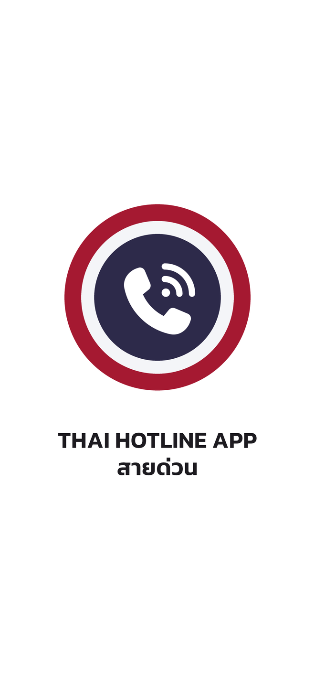
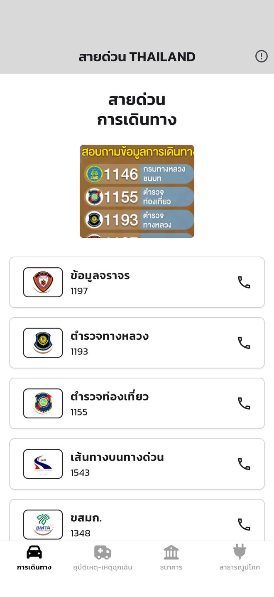
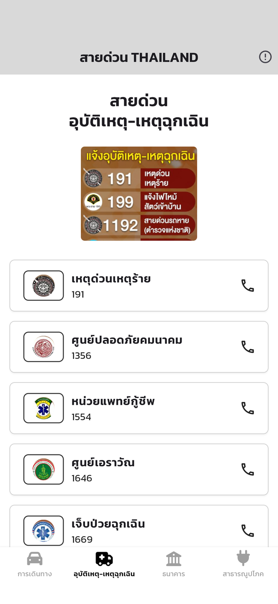
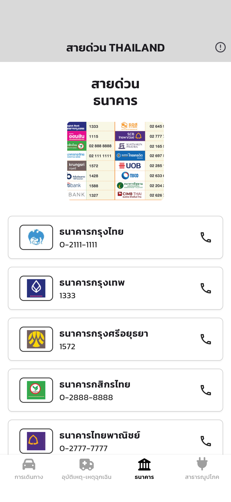
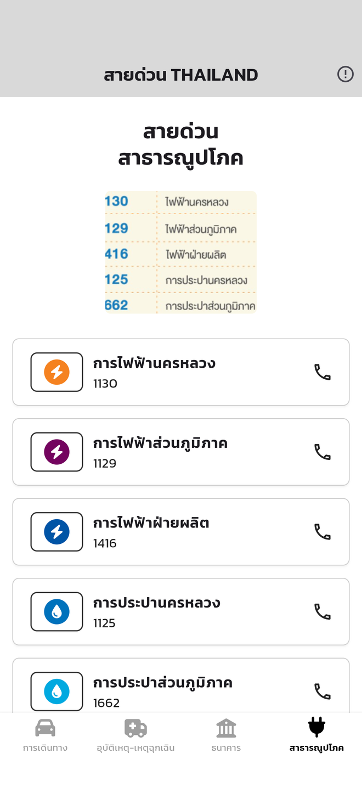
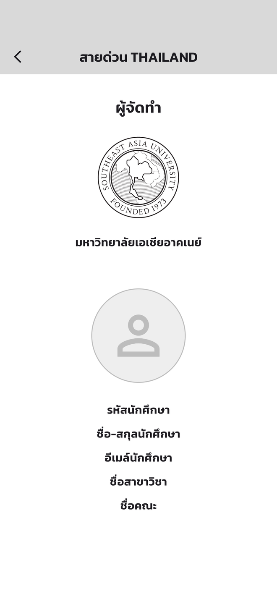

# 03-flutter_comeng_project

**สายด่วน THAILAND** — a Thai hotline app built from the Figma wireframe
"Mobile App: flutter_thai_hotline_app" (tested at iPhone 16 Pro Max size, 440 x 956).
Main font: Kanit (google_fonts). Tap a hotline card or its phone icon to call (url_launcher).

## Screenshots

Captured from the running app at iPhone 16 Pro Max size (440 x 956).

<table>
  <tr>
    <td align="center"><br><b>SplashScreenUI</b><br>หน้าแรก</td>
    <td align="center"><br><b>SubAHomeUI</b><br>การเดินทาง</td>
    <td align="center"><br><b>SubBHomeUI</b><br>อุบัติเหตุ-เหตุฉุกเฉิน</td>
  </tr>
  <tr>
    <td align="center"><br><b>SubCHomeUI</b><br>ธนาคาร</td>
    <td align="center"><br><b>SubDHomeUI</b><br>สาธารณูปโภค</td>
    <td align="center"><br><b>AboutUI</b><br>ผู้จัดทำ</td>
  </tr>
</table>

## Screens

| File | Class | Screen |
| --- | --- | --- |
| `lib/views/splash_screen_ui.dart` | `SplashScreenUI` | First page, goes to HomeUI after 3 seconds |
| `lib/views/home_ui.dart` | `HomeUI` | AppBar + BottomNavigationBar that switches SubA–SubD |
| `lib/views/sub_a_home_ui.dart` | `SubAHomeUI` | สายด่วน การเดินทาง (9 numbers) |
| `lib/views/sub_b_home_ui.dart` | `SubBHomeUI` | สายด่วน อุบัติเหตุ-เหตุฉุกเฉิน (9 numbers) |
| `lib/views/sub_c_home_ui.dart` | `SubCHomeUI` | สายด่วน ธนาคาร (16 numbers) |
| `lib/views/sub_d_home_ui.dart` | `SubDHomeUI` | สายด่วน สาธารณูปโภค (9 numbers) |
| `lib/views/about_ui.dart` | `AboutUI` | ผู้จัดทำ (opened from the info icon) |

Shared parts: `lib/models/hotline.dart` (data) and `lib/widgets/hotline_widgets.dart` (list + card).

## Images

- Hotline logos and banners: cut from the reference posters in the Figma file (`assets/images/logos`, `assets/images/banners`).
- University logo: [Logosau-02.png](https://commons.wikimedia.org/wiki/File:Logosau-02.png) (CC BY-SA 4.0).
- App logo / launcher icon and the electricity/water icons: drawn with FontAwesome glyphs.

## Run

```sh
flutter pub get
flutter run -d chrome
```

## Quality checks

```sh
flutter analyze
flutter test
```
